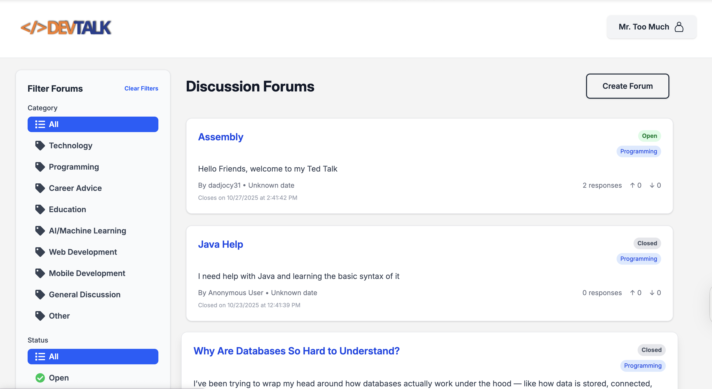

# DevTalk: AI Forum Voting App
## Team
- Tyran
- Nicole
- Devyn
- Jayden

## Screenshot


## A description of the app
- A full-stack web application where users create accounts, start forums based on questions or problems, vote on responses, and view AI-generated summaries after forums close.
- Users can register, log in, post anonymously, create/join forums, upvote/downvote responses, and view AI summaries.
- Admin functionality is part of the roadmap for managing forums and moderating content.

## Core features:
  - Forum creation and participation
  - Voting on responses
  - AI-powered summary and action roadmap after forum closure
  - Authentication workflows
 
## My contribution
My primary focus was supporting AI workflow integration, structured OpenAI API outputs, Firebase-connected front-end workflows, forum/message testing, and usability improvements. I also contributed to documentation and testing flows to make the project easier to understand and maintain.

## Tech Stack:
  - React, React Router, TypeScript, Vite, TailwindCSS
  - Firebase (Firestore, Auth)
  - OpenAI API for AI summaries
  - Jest, Testing Library for tests
  - Hosted on Vercel

## Demo link
- https://capstoneproject-chi.vercel.app

## Installation instructions
- Prerequisites: Node.js, npm, Firebase project and keys
- Clone the repo and install dependencies:
  ```sh
  npm install
  ```
- Set up environment variables in `.env.local` using `.env.example` as a template.
- Start development server:
  ```sh
  npm run dev
  ```
- Build for production:
  ```sh
  npm run build
  ```
- Run tests:
  ```sh
  npm test
  ```

## Current Status & Roadmap

DevTalk is an active project that I continue to improve as I refine the product experience, reliability, and AI workflow quality.

### Currently implemented
- Forum creation and browsing workflows
- User-facing discussion and message flows
- Voting interaction flows
- Firebase-connected account and forum data structure
- OpenAI-powered analysis for summaries, suggestions, and action roadmaps
- Forum result pages that combine discussion, voting, and message context
- Automated tests across forum creation, browsing, messaging, routing, and service logic

### In progress
- Improving login, logout, registration, and session persistence
- Strengthening Firebase saving and account data reliability
- Refining anonymous mode and display-name handling
- Improving voting responsiveness and real-time updates
- Enhancing forum page UI and result presentation
- Expanding admin edit/delete functionality
- Improving message feedback and notification flows


## Credits
- Team: Tyran, Nicole, Devyn, Jayden
- Libraries: [React](https://react.dev/), [React Router](https://reactrouter.com/), [Firebase](https://firebase.google.com/), [OpenAI](https://platform.openai.com/), [TailwindCSS](https://tailwindcss.com/), [Jest](https://jestjs.io/)
- APIs: OpenAI, Firebase
