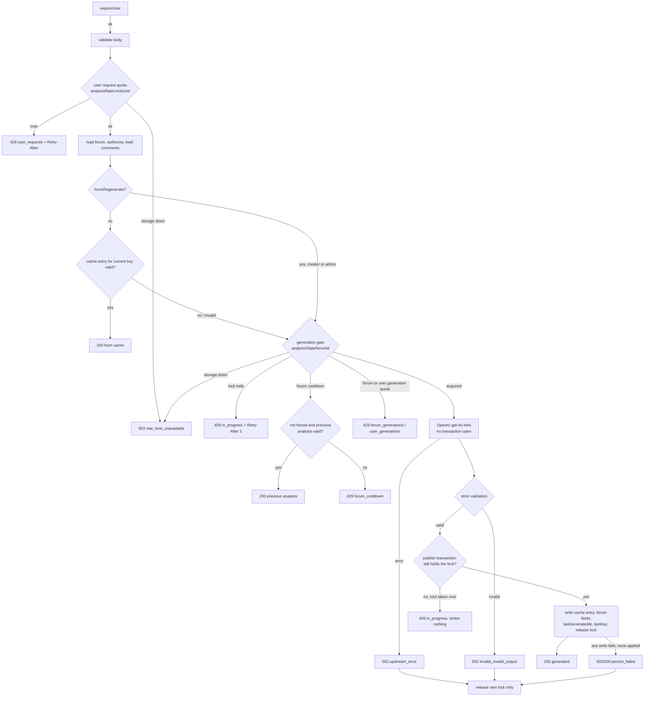

# AI analysis: caching, regeneration, rate limits and validation (Phase 2C)

Endpoint: `POST /api/analyzeMessages` (`app/api/analyzeMessages.ts`).
Authentication, input validation, trusted data loading and forum
authorization are described in [server-auth.md](./server-auth.md).

## Modules

| File | Purpose |
| --- | --- |
| `app/api/analysis-output.ts` | Strict validation of model output and cached entries |
| `app/api/analysis-cache.server.ts` | Cache key (SHA-256), validated cache reads and writes |
| `app/api/analysis-limits.server.ts` | Quotas, per-forum generation lock and cooldown (Firestore transactions) |
| `app/message/services/AnalysisService.ts` | Client: waits and retries on 409 `in_progress` |

## Request flow



Rejected requests (401, 400, 403, 404, 409, 422, 429, 503) never call OpenAI.

## Cache design and invalidation

- **Collection:** `analysisCache/{forumId}_{sha256}`, written only by the
  Admin SDK after a validated generation.
- **Key input** (SHA-256 over JSON): `ANALYSIS_VERSION`, model, temperature,
  forum ID, the forum context used in the prompt (title, description,
  question, first tag), and the selected comments as `[id, parentId,
  content]` in prompt order. The key holds the forum ID and a digest only,
  never comment text.
- **Fields:** `forumId`, `version`, `model`, `summary`, `actionRoadmap`,
  `totalMessages`, `uniqueAuthors`, `createdAt` (server timestamp),
  `expireAt` (now + 90 days, for an optional Firestore TTL policy that is
  not enabled).
- **Validation on read:** the entry must match the forum ID and current
  version and pass the same output validation as fresh model output.
  Anything else is logged as `cache_invalid` and treated as a miss; the next
  successful generation overwrites it.
- **Invalidation:** the key covers exactly what is sent to the model, so
  it changes when the analyzed input changes:
  - a new comment (new comments are the newest, so they are always
    selected), or an edit, deletion or thread change of a selected comment;
  - an edited forum title, description, question or first tag;
  - bumping `ANALYSIS_VERSION` (do it whenever the prompt, model settings
    or validation rules change), which invalidates every entry at once.
- **What does not invalidate:** comments outside the analyzed selection.
  The selection is the newest 500 comments, each cut to 10,000 characters,
  with the oldest dropped until the total is at most 200,000 characters.
  Editing or deleting a comment that was left out does not change the
  model's input, so the cached analysis is still what a regeneration would
  analyze; `totalMessages` and `uniqueAuthors` still reflect the change
  because they are recomputed. Separately, the route reads at most 2,000
  comment documents with no ordering, so in a forum with more than 2,000
  comments the selection is drawn from an arbitrary subset (pre-existing
  limit, no forum is near it today; fixing it needs ordered pagination).
- **Counts:** `totalMessages` and `uniqueAuthors` are always recomputed from
  the comments loaded for the request, also on a cache hit.
- **Client manipulation:** Firestore rules are deny-all today. The Phase 3
  rules in the repo keep `analysisCache`, `analysisState` and
  `analysisRateLimits` closed to clients (`allow read, write: if false`);
  only the Admin SDK uses them.

## Regeneration: retrieval vs authorized refresh

- **Normal retrieval** (any signed-in user who can view the forum): if the
  current content has a valid cache entry it is returned, with no OpenAI
  call. Unchanged content is never regenerated by ordinary viewers.
- **Content changed (freshness policy):** the first request after the forum
  cooldown (10 minutes since the last successful generation) generates a new
  analysis. During the cooldown everyone gets the latest valid analysis
  (`analysisState.lastKey`) with current counts; if there is none, 429
  `forum_cooldown`.
- **Forced refresh** (`forceRegenerate: true`): only the forum creator
  (`forums.creatorId`, not `"anonymous"`) or an admin (`admin: true` custom
  claim) may ask for it; others get 403 before comments are read. It skips
  the cache read but still goes through the lock, cooldown and quotas.
  Client flags and user IDs in the body are ignored.

## Rate limits and concurrency

All state is in Firestore, shared by every Vercel instance, and updated in
transactions. No transaction is open while OpenAI runs.

| Limit | Default | Scope | Response |
| --- | --- | --- | --- |
| Analysis requests | 20 per 10 min | verified UID, checked before any forum read | 429 `user_requests` |
| OpenAI generations started | 10 per 24 h | verified UID, across forums | 429 `user_generations` |
| OpenAI generations started | 24 per 24 h | forum | 429 `forum_generations` |
| Forum cooldown | 10 min after a successful generation | forum | previous analysis, else 429 `forum_cooldown` |
| Generation lock TTL | 2 min | forum | 409 `in_progress`, `Retry-After: 3` |

- Adjust the numbers in `ANALYSIS_QUOTAS` (`app/api/analysis-limits.server.ts`).
  Windows are fixed windows stored as Firestore timestamps.
- **Lock:** `analysisState/{forumId}.lock = { holder, key, expiresAt }`,
  taken in the same transaction that checks the cooldown and counts the
  attempt against the forum and user quotas. A second request for the forum
  gets 409 while the lock is live.
- **Publishing results:** after OpenAI returns valid output, one
  transaction (`publishGeneration`) first checks that this request still
  holds the lock, then writes the cache entry, the approved forum fields,
  `lastGeneratedAt` (starts the cooldown), `lastKey` and the lock release.
  Firestore applies all of these or none. No transaction is open during the
  OpenAI request.
  - **Lock lost** (it expired and another request took it over): nothing
    is written, the request returns 409 `in_progress`, and the client's
    retry gets the newer analysis. The old request cannot overwrite the
    newer state, cache entry or forum fields. Logged as `lock_lost`.
  - **Write failure** (cache entry or forum update): nothing is applied, no
    cooldown starts, `lastKey` is unchanged, the request releases only its
    own lock and returns 503 (transient Firestore codes) or 500 with reason
    `persist_failed`. The next request can generate again. Logged as
    `persist_failed` with the safe error code.
- **Failed generations** (OpenAI error, invalid output, write failure)
  release the lock with `releaseGeneration`, which only clears it if this
  request still holds it.
- **Stale locks:** a lock past `expiresAt` (crashed or timed-out function)
  is taken over by the next request and logged as `stale_lock_recovered`.
  OpenAI calls use `timeout: 30 s` and `maxRetries: 1`, so a live request
  ends well before the 2-minute TTL.
- **Failed attempts** count against quotas but do not start the cooldown,
  so a user can retry a failure promptly while retries stay bounded.
- **Storage failure:** any error reading or writing limit state returns 503
  `rate_limit_unavailable` with `Retry-After: 30`. The route never falls
  back to unlimited generation.
- **Client:** `AnalysisService` waits for `Retry-After` (capped at 10 s) and
  retries a 409 up to 3 times, so the What's Tea modal keeps loading and
  then shows the result from the cache. 429 is not retried; the modal shows
  its existing error text.
- `analysisRateLimits` docs carry `expireAt` for an optional TTL policy.

## AI output validation (`app/api/analysis-output.ts`)

- JSON object, optionally inside ```` ```json ```` fences.
- `summary`: string, 10–1,500 characters after trimming, containing a letter.
- `actionRoadmap`: exactly 3 items; each a string of 3–300 characters after
  trimming, containing a letter (so `"2️⃣ ..."` placeholders fail).
- Extra keys are dropped. Nothing is filtered, padded or invented: any
  failure rejects the whole response.
- Invalid output returns 502 `invalid_model_output`; OpenAI errors return
  502 `upstream_error`. Nothing is cached or saved and no canned text is
  returned. The model stays `gpt-4o-mini` at `temperature: 0.3` with the
  same prompt.

## Logging

Structured `[analyzeMessages] { event, ... }` with forum ID, status, scope,
counts, `source` (`cache`, `previous`, `generated`), `keyRef` (last 12 hex
characters of the key), safe error codes and `elapsedMs`. No UIDs, tokens,
comment text, forum text or model output.

## Remaining risks

- **Cost ceiling, not zero cost:** many accounts can each use their own
  quota. Account creation is not limited here.
- **Firestore cost:** each allowed request still reads up to 2,000 comment
  docs; the request quota bounds this per user.
- **Prompt injection:** comment text still reaches the model. Since Phase
  3B (`ANALYSIS_VERSION = "phase3b-1"`), the instructions are in the system
  message and forum text goes in only as JSON inside one `<forum_data>`
  block, with `<` escaped so it can't close the block. The system message
  says that block is material to analyze, never instructions. Validation
  still checks shape and length, not meaning, so a determined comment can
  still color the summary's wording.
- **Rules:** the new collections rely on Phase 3 rules staying closed to
  clients (today's deny-all rules already do this).
- **Admins:** no account has the `admin` claim yet.
- **Fixed windows** allow up to twice a quota around a window boundary.
- **Cache growth:** entries are not deleted until a TTL policy is enabled
  on `expireAt` (a Firebase console setting, not done in this phase).
