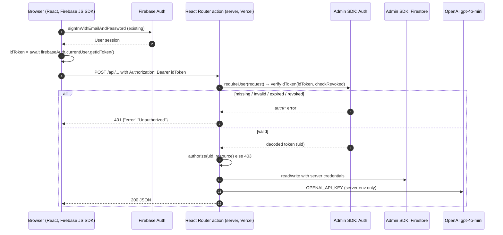

# Server-side Firebase access and authentication (Phase 1)

Status: foundation only. No route uses these modules yet, and production
behavior is unchanged. Labels: **Verified** (checked in code or by running it),
**Inferred** (reasoned, not run), **Proposed** (not built yet).

## Modules

| File | Runs on | Job |
| --- | --- | --- |
| `app/firebase/admin-project.server.ts` | server | Project isolation checks (validation only): allow-listed `FIREBASE_ADMIN_PROJECT_ID`, service-account and ADC project checks. Throws `AdminConfigError`. |
| `app/firebase/admin-credential.server.ts` | server | Builds Admin SDK options from env, always pinned to the validated project: service-account fields if set, else Application Default Credentials (ADC). |
| `app/firebase/admin.server.ts` | server | One named Admin app (`devtalk-admin`), created on first use and reused; a cached app for another project is refused. Exposes `getAdminAuth()` and `getAdminDb()`. |
| `app/auth/bearer-token.ts` | either | Parses `Authorization: Bearer <token>`. |
| `app/auth/authenticate.server.ts` | server | `requireUser(request)`: verifies the ID token (with revocation check) and returns `{ uid, token }`, or throws a sanitized 401, 503 or 500 `Response`. |
| `app/auth/classify-auth-error.ts` | either | Maps documented firebase-admin error codes to 401 / 503 / 500. |
| `app/auth/authorize.ts` | either | Authorization, kept separate: `requireOwner(user, ownerUid)` throws a 403 `Response`. |
| `app/auth/responses.ts` | either | Small JSON error `Response` helper. |

The `.server.ts` suffix is React Router's convention: the build fails if
browser code imports such a module. A Jest test
(`app/firebase/__tests__/server-only-imports.test.ts`) also fails if
`firebase-admin` is imported anywhere else. **Verified**: `build/client` has no
`firebase-admin` code after `npm run build`.

The Admin SDK bypasses Firestore Security Rules, so every route that uses
`getAdminDb()` must call `requireUser` and then an explicit authorization check
before it reads or writes.

## Request flow



## How the browser should send the token

**Verified**: the app signs users in with the Firebase JS SDK
(`app/account/login.tsx`, `app/account/signup.tsx`) and reads the user through
`onAuthStateChanged(firebaseAuth, …)` (e.g. `app/forum/forum-detail.tsx`). No
code calls `getIdToken()` or sends an `Authorization` header today.

**Proposed** pattern for each authenticated call:

```ts
import { firebaseAuth } from "~/firebase/config";

const user = firebaseAuth.currentUser;
if (!user) throw new Error("Sign in first");
const idToken = await user.getIdToken(); // SDK refreshes it when near expiry
await fetch("/api/analyzeMessages", {
  method: "POST",
  headers: { "Content-Type": "application/json", Authorization: `Bearer ${idToken}` },
  body: JSON.stringify(payload), // never include a uid; the server takes it from the token
});
```

Tokens last one hour; `getIdToken()` returns a fresh one when needed. On a
401, the client can retry once with `getIdToken(true)` and then send the user to
`/login`.

## Credentials

### Local development (ADC) **Inferred**, not run here

```sh
gcloud auth application-default login
gcloud auth application-default set-quota-project devtalk-88046
# .env.local
FIREBASE_ADMIN_PROJECT_ID=devtalk-88046
```

Leave `FIREBASE_ADMIN_CLIENT_EMAIL` and `FIREBASE_ADMIN_PRIVATE_KEY` unset and
the module uses ADC. For offline work, the Admin SDK also honors
`FIREBASE_AUTH_EMULATOR_HOST` and `FIRESTORE_EMULATOR_HOST` (Emulator Suite).

### Production on Vercel **Proposed**, nothing set yet

Vercel has no ADC, so the server needs a credential from env. Two options:

1. **Service-account fields as server-only env vars** (what the code supports
   now): set `FIREBASE_ADMIN_PROJECT_ID`, `FIREBASE_ADMIN_CLIENT_EMAIL` and
   `FIREBASE_ADMIN_PRIVATE_KEY` in Vercel, marked Sensitive, without a `VITE_`
   prefix so Vite never inlines them. Use a dedicated service account with only
   the roles the server needs (Firebase Authentication Viewer for revocation
   checks, Cloud Datastore User for Firestore), not the default Firebase Admin
   SDK account. The key must never be committed or pasted into chat or logs.
2. **No stored key, via Vercel OIDC and Google Workload Identity Federation**:
   Vercel issues a short-lived token that Google exchanges for access. Safer,
   but it needs extra setup in Google Cloud and Vercel plus a small credential
   adapter. Worth doing once the app is stable; not built in this phase.

## New environment variable names (server-only)

| Name | Needed when | Notes |
| --- | --- | --- |
| `FIREBASE_ADMIN_PROJECT_ID` | Always (required) | Must be `devtalk-88046` |
| `FIREBASE_ADMIN_CLIENT_EMAIL` | Vercel (option 1) | Service-account email |
| `FIREBASE_ADMIN_PRIVATE_KEY` | Vercel (option 1) | PEM key; literal `\n` is converted to newlines |

If only some of the key fields are set, the server throws an error that names
the missing variables (never values).

## Project isolation (Phase 1.1)

- `FIREBASE_ADMIN_PROJECT_ID` is required, trimmed, and must be in
  `ALLOWED_ADMIN_PROJECT_IDS` (`devtalk-88046` only). `codesocietycapstone`
  and any other value are rejected.
- The validated ID is always passed to `initializeApp`, so Auth (token
  audience) and Firestore target it rather than whatever ADC would infer.
- Service-account mode: `FIREBASE_ADMIN_CLIENT_EMAIL` must end in
  `@devtalk-88046.iam.gserviceaccount.com`.
- ADC mode: `GOOGLE_CLOUD_PROJECT` / `GCLOUD_PROJECT`, if set, must match, and a
  key file named by `GOOGLE_APPLICATION_CREDENTIALS` must not carry another
  `project_id`. Gcloud user logins and federated (`external_account`) files
  have no project and are allowed, which keeps local ADC and future Vercel
  OIDC working.
- A cached Admin app whose project differs from the current config is refused.
- All failures are `AdminConfigError` (`admin/invalid-config`) with messages
  that name variables, never values. `requireUser` turns them into a 500.

## Authentication error classification (Phase 1.1)

| Condition | Firebase code(s) | HTTP |
| --- | --- | --- |
| Missing or malformed `Authorization` header | (none; checked before Firebase) | 401 |
| Invalid / malformed token, bad signature, wrong project audience | `auth/argument-error`, `auth/invalid-id-token` | 401 |
| Expired token | `auth/id-token-expired` | 401 |
| Revoked token | `auth/id-token-revoked` | 401 |
| Disabled or deleted account | `auth/user-disabled`, `auth/user-not-found` | 401 |
| User lacks permission | `requireOwner` in `authorize.ts` | 403 |
| Firebase unavailable or throttled | `auth/internal-error`, `auth/quota-exceeded`, `app/network-error`, `app/network-timeout` | 503 + `Retry-After` |
| Server credential or configuration failure | `admin/invalid-config`, `auth/invalid-credential`, `app/invalid-credential`, `auth/insufficient-permission`, `auth/project-not-found` | 500 |
| Anything else, including unknown `auth/*` codes | | 500 |

Codes come from `AuthErrorCode` and `AppErrorCode` in firebase-admin 14.5.0.
Response bodies are fixed strings. Logs are one structured object,
`{ event: "auth.verify_failed", status, category, code }`, where `code` is
replaced with `unknown` unless it matches `^(auth|app|admin)/[a-z0-9-]+$`.

**Known limit:** if Google's public signing keys can't be fetched, the SDK
reports `auth/argument-error`, the same code as a bad token, so that outage
returns 401 rather than 503. Telling them apart would mean parsing messages.

## AI analysis endpoint (`app/api/analyzeMessages.ts`), Phase 2B

Steps 1–5 and 7 of the original migration plan are done (Phase 2A sent the
token and validated input; Phase 2B enforces auth and uses trusted data).
Phase 2C added caching, rate limits, a generation lock and strict output
validation; see [ai-analysis.md](./ai-analysis.md), which replaces steps 8–10
and the cost risk below.

### Firestore fields used (Verified from the code that writes them)

| Purpose | Collection.field | Written by |
| --- | --- | --- |
| Forum owner | `forums.creatorId` (UID, or `"anonymous"`) | `forum/create-forum.tsx` |
| Visibility | `forums.isActive` (forum list hides `false`), `forums.isAdminDeleted` | `create-forum.tsx`, `hooks/useFirestore.ts` |
| Closure | `forums.endTime` (closed forums stay viewable) | `create-forum.tsx` |
| Forum context | `forums.title`, `description`, `question`, `tags[0]` | `create-forum.tsx` |
| Comment author | `comments.userId` (UID, or `"anonymous"` when signed out), `comments.userName` (display name or `"Anonymous User"`) | `forum/forum-detail.tsx` |
| Comment → forum | `comments.forumId` | `forum-detail.tsx` |
| Thread | `comments.parentId` (declared in `useFirestore.ts`; nothing writes it yet, so all comments are thread `"main"`, as before) | — |
| Analysis | `forums.analysisSummary`, `forums.actionRoadmap`, `forums.lastAnalyzedAt`; cache `analysisCache/{<forumId>_<sha256>}` (Phase 2C) | this route |
| Admin | none on the server. The app's only admin check is a hardcoded UID in the browser (`account/login.tsx`), which the server ignores | — |

### Request flow

`forum-detail.tsx` → "What's Tea" → `TeaModal` → `AnalysisService.analyzeMessages({ forumId })`
with `Authorization: Bearer <ID token>` → `POST /api/analyzeMessages`:

1. `requireUser(request)`: 401 / 503 / 500 per the Phase 1.1 table. Nothing
   else runs on failure.
2. Body: `{ forumId, forceRegenerate? }` (≤ 512 KiB JSON, `forumId` matches
   `^[A-Za-z0-9_-]{1,128}$`, `forceRegenerate` boolean). Everything else the
   client sends (messages, titles, `uid`, admin flags) is ignored. 400 / 413.
3. Forum loaded with `getAdminDb()`. 404 if missing.
4. Authorization (`app/auth/forum-access.ts`), 403 on failure:
   - `isAdminDeleted: true` → admins only (even the creator is refused).
   - `isActive: false` → creator or admin.
   - otherwise any signed-in user (matches what the forum page shows).
   - `forceRegenerate: true` (skip the cache) → creator or admin.
   - Admin = verified ID token custom claim `admin: true`. No account has it
     yet, so admin rights are off and those paths fail closed.
5. Comments: `comments where forumId == id`, at most 2,000 docs read. 422
   `no_comments` if there are none (OpenAI is not called).
6. Limits before OpenAI: newest 500 comments, 10,000 chars each, 200,000
   chars total (oldest dropped first).
7. `totalMessages` = comments loaded; `uniqueAuthors` = distinct `userId`,
   else (legacy) case-insensitive `userName`. `"anonymous"` IDs, `"Anonymous
   User"` names and missing authors are not counted.
8. Cache read (skipped when forcing), then the unchanged `gpt-4o-mini`
   prompt with `temperature: 0.3`, built from the trusted forum and comments.
9. Only a successfully parsed analysis is saved, and only `analysisSummary`,
   `actionRoadmap` (strings only) and `lastAnalyzedAt`. The fallback text is
   still returned to the user but no longer saved.
10. Firestore errors: gRPC 4 / 8 / 14 → 503, others → 500. OpenAI errors → 500.

Response shape is unchanged: `{ totalMessages, uniqueAuthors, summary, actionRoadmap }`.

### Logging

Server: one structured object per step, `[analyzeMessages] { event, forumId,
status, totalMessages, analyzedMessages, threads, responseLength, elapsedMs,
code }`. Client: `[TeaModal] analysis { forumId, outcome, elapsedMs }`. No
tokens, comment text, forum conversations, model output, UIDs or keys.

### Remaining risks (Phase 2B; see ai-analysis.md for the Phase 2C update)

- ~~**Cost abuse**~~: addressed in Phase 2C (cache, quotas, lock).
- **Any signed-in user can overwrite a forum's saved analysis fields** by
  requesting analysis (intended: viewers may analyze), but the saved value
  always comes from the server's own OpenAI call.
- **No admin role yet:** set an `admin` custom claim with the Admin SDK and
  remove the hardcoded browser UID before relying on admin paths.
- **Anonymous comments** still store the real UID in `userId` (pre-existing);
  it is only used for counting and is never sent to OpenAI or logged.
- **Comment prompt injection:** comment text goes to the model as before;
  the saved fields are type-checked but their wording is model-controlled.
- **2,000-doc read cap** has no ordering, so a forum with more comments
  analyzes an arbitrary subset (none are that large today).
- **Firestore rules** are still deny-all, so the forum page's own client
  reads fail until rules are published; this route does not depend on them.
