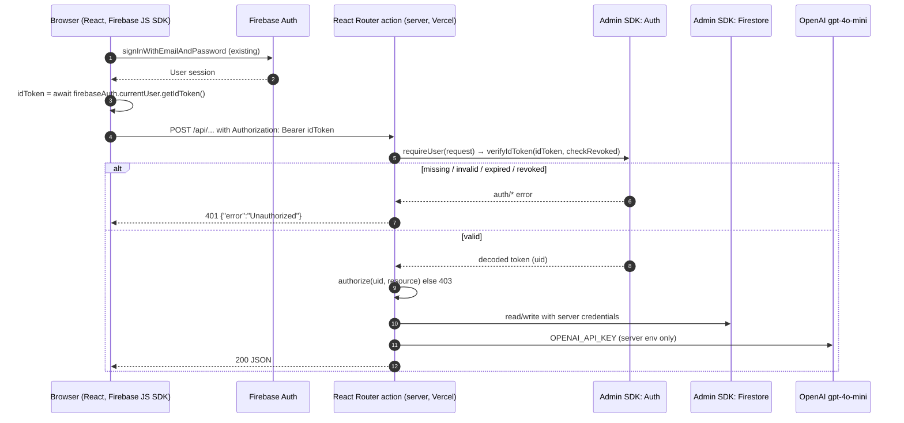

# Server-side Firebase access and authentication (Phase 1)

Status: foundation only. No route uses these modules yet, and production
behavior is unchanged. Labels: **Verified** (checked in code or by running it),
**Inferred** (reasoned, not run), **Proposed** (not built yet).

## Modules

| File | Runs on | Job |
| --- | --- | --- |
| `app/firebase/admin-project.server.ts` | server | Project isolation checks (validation only): allow-listed `FIREBASE_ADMIN_PROJECT_ID`, service-account and ADC project checks. Throws `AdminConfigError`. |
| `app/firebase/admin-credential.server.ts` | server | Builds Admin SDK options from env, always pinned to the validated project: service-account fields if set, else Application Default Credentials (ADC). |
| `app/firebase/admin.server.ts` | server | One named Admin app (`devtalk-admin`), created on first use and reused; a cached app for another project is refused. Exposes `getAdminAuth()` and `getAdminDb()`. |
| `app/auth/bearer-token.ts` | either | Parses `Authorization: Bearer <token>`. |
| `app/auth/authenticate.server.ts` | server | `requireUser(request)`: verifies the ID token (with revocation check) and returns `{ uid, token }`, or throws a sanitized 401, 503 or 500 `Response`. |
| `app/auth/classify-auth-error.ts` | either | Maps documented firebase-admin error codes to 401 / 503 / 500. |
| `app/auth/authorize.ts` | either | Authorization, kept separate: `requireOwner(user, ownerUid)` throws a 403 `Response`. |
| `app/auth/responses.ts` | either | Small JSON error `Response` helper. |

The `.server.ts` suffix is React Router's convention: the build fails if
browser code imports such a module. A Jest test
(`app/firebase/__tests__/server-only-imports.test.ts`) also fails if
`firebase-admin` is imported anywhere else. **Verified**: `build/client` has no
`firebase-admin` code after `npm run build`.

The Admin SDK bypasses Firestore Security Rules, so every route that uses
`getAdminDb()` must call `requireUser` and then an explicit authorization check
before it reads or writes.

## Request flow



## How the browser should send the token

**Verified**: the app signs users in with the Firebase JS SDK
(`app/account/login.tsx`, `app/account/signup.tsx`) and reads the user through
`onAuthStateChanged(firebaseAuth, …)` (e.g. `app/forum/forum-detail.tsx`). No
code calls `getIdToken()` or sends an `Authorization` header today.

**Proposed** pattern for each authenticated call:

```ts
import { firebaseAuth } from "~/firebase/config";

const user = firebaseAuth.currentUser;
if (!user) throw new Error("Sign in first");
const idToken = await user.getIdToken(); // SDK refreshes it when near expiry
await fetch("/api/analyzeMessages", {
  method: "POST",
  headers: { "Content-Type": "application/json", Authorization: `Bearer ${idToken}` },
  body: JSON.stringify(payload), // never include a uid; the server takes it from the token
});
```

Tokens last one hour; `getIdToken()` returns a fresh one when needed. On a
401, the client can retry once with `getIdToken(true)` and then send the user to
`/login`.

## Credentials

### Local development (ADC) **Inferred**, not run here

```sh
gcloud auth application-default login
gcloud auth application-default set-quota-project devtalk-88046
# .env.local
FIREBASE_ADMIN_PROJECT_ID=devtalk-88046
```

Leave `FIREBASE_ADMIN_CLIENT_EMAIL` and `FIREBASE_ADMIN_PRIVATE_KEY` unset and
the module uses ADC. For offline work, the Admin SDK also honors
`FIREBASE_AUTH_EMULATOR_HOST` and `FIRESTORE_EMULATOR_HOST` (Emulator Suite).

### Production on Vercel **Proposed**, nothing set yet

Vercel has no ADC, so the server needs a credential from env. Two options:

1. **Service-account fields as server-only env vars** (what the code supports
   now): set `FIREBASE_ADMIN_PROJECT_ID`, `FIREBASE_ADMIN_CLIENT_EMAIL` and
   `FIREBASE_ADMIN_PRIVATE_KEY` in Vercel, marked Sensitive, without a `VITE_`
   prefix so Vite never inlines them. Use a dedicated service account with only
   the roles the server needs (Firebase Authentication Viewer for revocation
   checks, Cloud Datastore User for Firestore), not the default Firebase Admin
   SDK account. The key must never be committed or pasted into chat or logs.
2. **No stored key, via Vercel OIDC and Google Workload Identity Federation**:
   Vercel issues a short-lived token that Google exchanges for access. Safer,
   but it needs extra setup in Google Cloud and Vercel plus a small credential
   adapter. Worth doing once the app is stable; not built in this phase.

## New environment variable names (server-only)

| Name | Needed when | Notes |
| --- | --- | --- |
| `FIREBASE_ADMIN_PROJECT_ID` | Always (required) | Must be `devtalk-88046` |
| `FIREBASE_ADMIN_CLIENT_EMAIL` | Vercel (option 1) | Service-account email |
| `FIREBASE_ADMIN_PRIVATE_KEY` | Vercel (option 1) | PEM key; literal `\n` is converted to newlines |

If only some of the key fields are set, the server throws an error that names
the missing variables (never values).

## Project isolation (Phase 1.1)

- `FIREBASE_ADMIN_PROJECT_ID` is required, trimmed, and must be in
  `ALLOWED_ADMIN_PROJECT_IDS` (`devtalk-88046` only). `codesocietycapstone`
  and any other value are rejected.
- The validated ID is always passed to `initializeApp`, so Auth (token
  audience) and Firestore target it rather than whatever ADC would infer.
- Service-account mode: `FIREBASE_ADMIN_CLIENT_EMAIL` must end in
  `@devtalk-88046.iam.gserviceaccount.com`.
- ADC mode: `GOOGLE_CLOUD_PROJECT` / `GCLOUD_PROJECT`, if set, must match, and a
  key file named by `GOOGLE_APPLICATION_CREDENTIALS` must not carry another
  `project_id`. Gcloud user logins and federated (`external_account`) files
  have no project and are allowed, which keeps local ADC and future Vercel
  OIDC working.
- A cached Admin app whose project differs from the current config is refused.
- All failures are `AdminConfigError` (`admin/invalid-config`) with messages
  that name variables, never values. `requireUser` turns them into a 500.

## Authentication error classification (Phase 1.1)

| Condition | Firebase code(s) | HTTP |
| --- | --- | --- |
| Missing or malformed `Authorization` header | (none; checked before Firebase) | 401 |
| Invalid / malformed token, bad signature, wrong project audience | `auth/argument-error`, `auth/invalid-id-token` | 401 |
| Expired token | `auth/id-token-expired` | 401 |
| Revoked token | `auth/id-token-revoked` | 401 |
| Disabled or deleted account | `auth/user-disabled`, `auth/user-not-found` | 401 |
| User lacks permission | `requireOwner` in `authorize.ts` | 403 |
| Firebase unavailable or throttled | `auth/internal-error`, `auth/quota-exceeded`, `app/network-error`, `app/network-timeout` | 503 + `Retry-After` |
| Server credential or configuration failure | `admin/invalid-config`, `auth/invalid-credential`, `app/invalid-credential`, `auth/insufficient-permission`, `auth/project-not-found` | 500 |
| Anything else, including unknown `auth/*` codes | | 500 |

Codes come from `AuthErrorCode` and `AppErrorCode` in firebase-admin 14.5.0.
Response bodies are fixed strings. Logs are one structured object,
`{ event: "auth.verify_failed", status, category, code }`, where `code` is
replaced with `unknown` unless it matches `^(auth|app|admin)/[a-z0-9-]+$`.

**Known limit:** if Google's public signing keys can't be fetched, the SDK
reports `auth/argument-error`, the same code as a bad token, so that outage
returns 401 rather than 503. Telling them apart would mean parsing messages.

## Plan for `app/api/analyzeMessages.ts`

**Verified** current behavior:

- No authentication: any caller can POST (`action`, line ~38).
- Uses the browser Firebase SDK on the server (`import { db } from "../firebase/config.js"`),
  so reads and writes run unauthenticated and depend on Firestore rules.
  **Inferred**: under the current deny-all rules both fail (the cache read is
  caught and skipped; the forum update is caught and logged).
- Trusts client-sent `forumId` and `messages`; no payload validation.
- Writes `analysisSummary`, `actionRoadmap`, `lastAnalyzedAt` to `forums/{forumId}`,
  including a canned fallback summary when the model's JSON can't be parsed.
- Reads `analysisCache/{key}` but never writes it.
- Logs the full model output and the forum context (`console.log(aiResponse)`).
- Live caller: `TeaModal` through `AnalysisService.analyzeMessages`
  (`app/message/services/AnalysisService.ts`), only reached from
  `app/forum/forum-detail.tsx`, which already redirects signed-out users to
  `/login`. `MessageList.analyzeMessages` is defined but never invoked.

## Phase 2A status: transitional, not yet secure

Steps 1 and 2 below are done. **The endpoint still accepts unauthenticated
requests**; anyone can call it until Phase 2B adds `requireUser(request)`.

**Request flow (Verified):** `forum-detail.tsx` (redirects signed-out users to
`/login`) → "What's Tea" button → `TeaModal` reads the forum's `comments` with
the client SDK → `AnalysisService.analyzeMessages` → `POST /api/analyzeMessages`.
TeaModal sends `{ forumId, forumTitle, forumDescription?, forumQuestion?,
category?, messages: [{ id, content, userName, createdAt, forumId }] }`; the
server's old type expected `{ id: number, author, content, timestamp }`, so
`uniqueAuthors` is always 1 for TeaModal requests (unchanged here). Response:
`{ totalMessages, uniqueAuthors, summary, actionRoadmap }`. `MessageList`
also defines a call to the endpoint but never invokes it.

**Client (`AnalysisService`):** waits for `firebaseAuth.authStateReady()`, takes
`currentUser`, sends `Authorization: Bearer <getIdToken()>`. A 401 is retried
once with `getIdToken(true)`. Failures throw `AnalysisAuthError` with reason
`signed_out`, `token_unavailable` or `unauthorized` (no token inside);
`TeaModal` shows "Please sign in again to spill the tea" for these and keeps
its existing message for other errors.

**Server validation (`app/api/analyze-request.ts`)**, before any Firestore or
OpenAI call. Failures return `{ error: "Invalid request", reason }` with 400,
or `{ error: "Request too large", reason: "body_too_large" }` with 413.

| Rule | Limit / format | Why |
| --- | --- | --- |
| Body size | 512 KiB (Content-Length checked first, then actual bytes) | Fits 200k chars of mostly-ASCII content plus normal metadata; an outer cap even if every field is near its own limit. Vercel allows 4.5 MB |
| JSON | must parse to a plain object | |
| `forumId` | required, `^[A-Za-z0-9_-]{1,128}$`, not `__x__` | Firestore auto-IDs are 20 alphanumerics; blocks paths like `a/b` |
| `forumTitle`, `forumDescription`, `forumQuestion`, `category` | optional strings, ≤ 2,000 chars | |
| `messages` | array of 1–500 | the 43 migrated docs span all forums; ample headroom |
| message `id` | doc-ID string or non-negative integer | TeaModal sends doc IDs, older callers numbers |
| message `content` | required string, ≤ 10,000 chars | |
| total `content` | ≤ 200,000 chars (~50k tokens) | bounds OpenAI prompt size and cost |
| `author`, `userName`, `timestamp`, `threadId`, `forumId` | optional strings, ≤ 2,000 chars | |
| `createdAt` | optional: string, `null`, or `{ seconds, nanoseconds, type? }` | how a Firestore Timestamp serializes |

Only these fields are copied forward; anything else (for example `uid`,
`userId`) is dropped, so client-supplied user IDs can never drive
authorization.

**Proposed** migration, one small PR each, in order:

1. **Client sends the token.** `AnalysisService` adds the `Authorization`
   header from `firebaseAuth.currentUser.getIdToken()`. The server still
   accepts calls without it, so nothing breaks.
2. **Server validates the payload.** Require a non-empty string `forumId`
   (Firestore id characters only) and cap message count and length; return 400
   otherwise. Ignore any `uid` / `userId` in the body.
3. **Server requires auth.** Call `requireUser(request)` first; 401 without a
   valid token. Ship after step 1 is deployed so live clients already send it.
4. **Server reads its own data.** Load the forum and its comments with
   `getAdminDb()` instead of trusting client `messages`; 404 if the forum is
   missing or `isAdminDeleted`.
5. **Authorize the write.** Decide who may refresh a forum's analysis (open
   question below), then write only `analysisSummary`, `actionRoadmap`,
   `lastAnalyzedAt` through the Admin SDK. Stop persisting the fallback
   summary (already queued as its own ticket).
6. **Cache server-side.** Read and write `analysisCache` with the Admin SDK;
   rules keep it closed to clients.
7. **Trim logs.** Log ids and counts only, never message text or model output.

**Compatibility requirements**

- Keep the response shape `{ totalMessages, uniqueAuthors, summary, actionRoadmap }`
  and the `gpt-4o-mini` call (model, prompt, `temperature: 0.3`).
- `OPENAI_API_KEY` stays server-only (`process.env`, no `VITE_` prefix).
- Step 1 must be deployed before step 3, or the Tea modal will get 401s.
- The server needs Admin credentials in Vercel before step 4.

**Open questions for Devyn**

- Who may trigger analysis for a forum: any signed-in user, only the creator
  (`creatorId`), or admins? This decides the authorization check in step 5.
- Which Vercel credential option to use (service-account fields now, or
  Workload Identity Federation).
